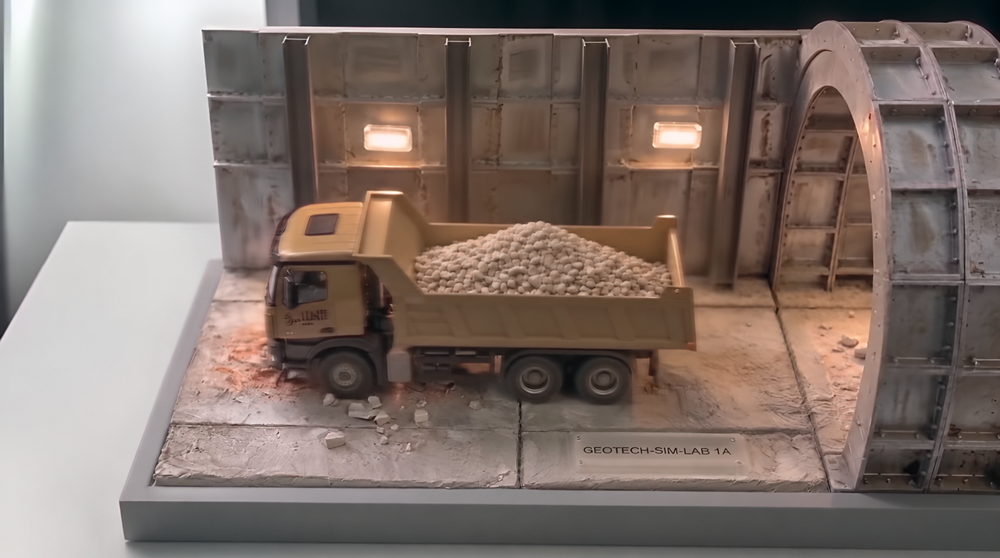
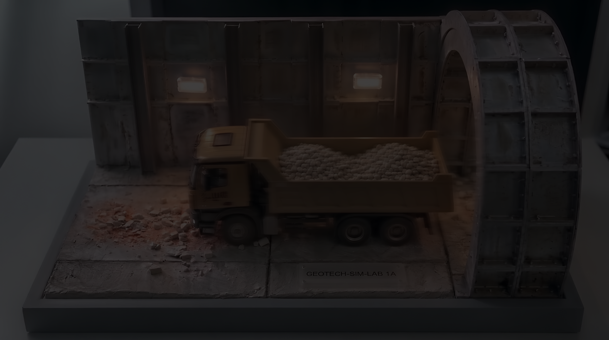
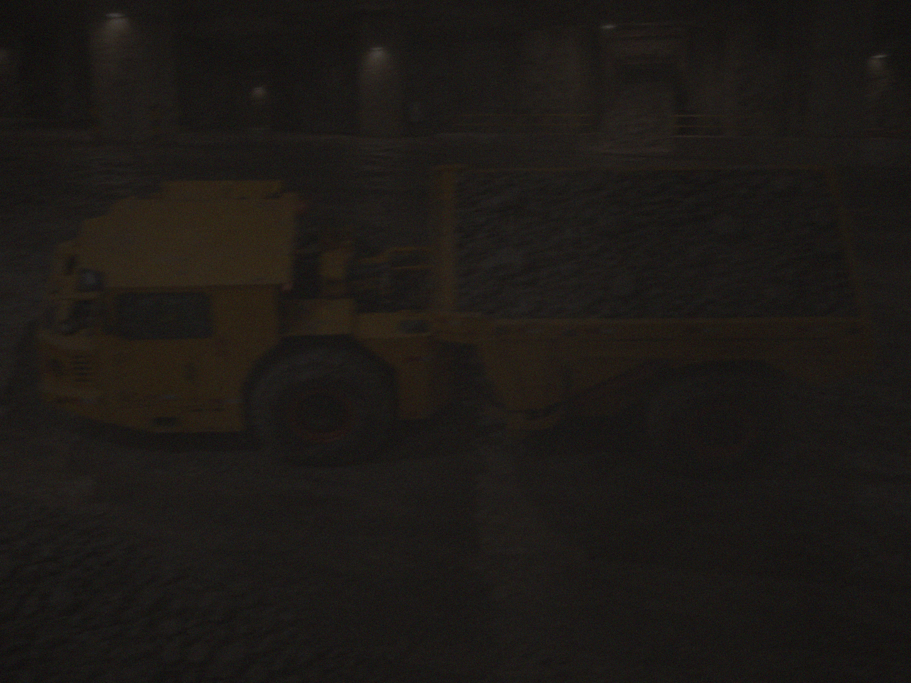

# TOFD-YOLO Datasets

**Fine-grained loading-level detection under held-out indoor conditions and synthetic underground scene changes.**

This repository documents two YOLO-format loading-region datasets associated with *TOFD-YOLO-Based Visual Perception and Transport-Event Association for Underground Ore Flow*. The datasets support experiments on adjacent loading-level discrimination, robustness to imaging conditions, and generalization to unseen synthetic backgrounds.

The collection contains **3,402 annotated images across seven loading classes**. The indoor collection contains 1,260 base images and 1,792 additional training augmentations. The synthetic collection contains 350 images across five underground backgrounds.

> These packages contain loading-region annotations. Separate truck-detection, barcode-detection, real loader-bucket OBB datasets, model weights, and transport-event video clips are not included in the two folders documented here. Synthetic underground images are not field-acquired underground observations.

## Dataset overview

| Dataset | Train | Validation | Test | Total | Evaluation focus |
| --- | ---: | ---: | ---: | ---: | --- |
| `Indoor_condition_dataset` | 2,016 | 112 | 924 | 3,052 | Held-out illumination, speed, and ore-pile morphology |
| `Multiscene_synthetic_dataset` | 210 | 70 | 70 | 350 | Background changes across synthetic underground scenes |

The supplied files contain one annotated loading region per image. Each image has a matching text label file. Training, validation, and test partitions are provided and should be retained for comparisons using the documented protocols.

## Example images

The following examples are direct copies of dataset images, without resizing or recompression. Bounding-box overlays have not been added.

| Indoor training example | Indoor held-out example | Synthetic held-out chamber |
| --- | --- | --- |
|  |  |  |

Original filenames, source splits, and corresponding YOLO labels are recorded in [`assets/SAMPLES.md`](assets/SAMPLES.md).

## Download

Full image and annotation archives are intended to be distributed through this repository's **Releases** page. Download the dataset assets separately from the repository source archive.

### Indoor dataset: download both ZIP files

The complete indoor dataset is distributed as **two independent ZIP archives**. Both are required to restore the complete dataset. Each archive is smaller than **2,000,000,000 bytes (decimal 2 GB)**.

| Release asset | Exact size (bytes) | Size (decimal MB) | Contents |
| --- | ---: | ---: | --- |
| `Indoor_condition_dataset_part01_train.zip` | 1,688,934,102 | 1,688.93 | `images/train/`, `labels/train/`, and root metadata, YAML and README files |
| `Indoor_condition_dataset_part02_val_test.zip` | 1,503,775,407 | 1,503.78 | Validation and test images and labels, `test_slices/`, and remaining support files |

**Release download links:** to be added by the repository maintainer after uploading these exact assets.

Extract **both archives into the same parent directory**, such as `datasets/`. Both contain the common top-level folder `Indoor_condition_dataset/`; their file contents are complementary. They are ordinary ZIP files, not `.z01`/`.z02` split volumes. Do not concatenate them, extract them into separate dataset roots, or train on part 1 without restoring the validation and test files from part 2.

From the repository root, with both downloaded ZIP files in the current directory:

**Windows PowerShell**

```powershell
Expand-Archive -LiteralPath ./Indoor_condition_dataset_part01_train.zip -DestinationPath ./datasets
Expand-Archive -LiteralPath ./Indoor_condition_dataset_part02_val_test.zip -DestinationPath ./datasets
```

**Linux/macOS**

```bash
unzip Indoor_condition_dataset_part01_train.zip -d datasets
unzip Indoor_condition_dataset_part02_val_test.zip -d datasets
```

The restored indoor dataset contains 2,016 training, 112 validation, and 924 test images. The archives retain all 6,129 original files, including support files and existing caches. Image and annotation contents have not been re-encoded or changed. Every archived file was decoded and checked against the SHA-256 hash of its source bytes.

### Integrity checks

Archive hashes are provided in [`release_metadata/indoor/SHA256SUMS.txt`](release_metadata/indoor/SHA256SUMS.txt). Original paths, sizes, hashes and archive membership are recorded in [`dataset_manifest.csv`](release_metadata/indoor/dataset_manifest.csv).

On PowerShell, compute the archive hashes and compare them with the checksum file:

```powershell
Get-FileHash -Algorithm SHA256 ./Indoor_condition_dataset_part01_train.zip
Get-FileHash -Algorithm SHA256 ./Indoor_condition_dataset_part02_val_test.zip
Get-Content ./release_metadata/indoor/SHA256SUMS.txt
```

On Linux, verify both archives from the repository root:

```bash
sha256sum -c release_metadata/indoor/SHA256SUMS.txt
```

### Synthetic dataset and local paths

The two ZIP files above contain **only the indoor dataset**. The synthetic dataset is packaged separately as `Multiscene_synthetic_dataset.zip` (1,055,079,075 bytes, or 1,055.08 decimal MB). Download that separate release asset when published and extract it into the same `datasets/` parent directory; it contains the top-level folder `Multiscene_synthetic_dataset/`.

```powershell
# Windows PowerShell
Expand-Archive -LiteralPath ./Multiscene_synthetic_dataset.zip -DestinationPath ./datasets
```

```bash
# Linux/macOS
unzip Multiscene_synthetic_dataset.zip -d datasets
```

To obtain both complete datasets, download **three data archives in total**: the two indoor ZIP files and the separate synthetic ZIP file. The supplied indoor checksum file covers only the two indoor ZIP files.

Original configuration files and test lists retain their supplied paths. Once both datasets are extracted, run the [local configuration step](#local-configuration) to generate configurations for your workstation. The supplied helper expects both dataset folders to be present.

Preserve image filenames and directory structure. Re-encoding images or changing their dimensions creates a different data version and should be documented.

## Directory structure

```text
repository/
├── README.md
├── assets/                         # Small original-image examples
├── scripts/
│   └── prepare_configs.py          # Generate configurations for your local paths
├── release_metadata/
│   └── indoor/
│       ├── SHA256SUMS.txt          # Checksums of the two indoor ZIP assets
│       ├── dataset_manifest.csv    # Original file hashes and archive membership
│       └── EXTRACTION_README.txt
├── configs/                        # Generated locally by prepare_configs.py
└── datasets/                       # Extract release archives here
    ├── Indoor_condition_dataset/
    │   ├── images/{train,val,test}/
    │   ├── labels/{train,val,test}/
    │   ├── data.yaml
    │   ├── split_manifest.csv
    │   ├── augmentation_manifest.csv
    │   ├── base_split_audit.csv
    │   ├── README.md
    │   ├── AUGMENTATION_README.md
    │   └── test_slices/
    │       ├── test_all.txt
    │       ├── test_dark.txt
    │       ├── test_fast.txt
    │       ├── test_morphology.txt
    │       ├── test_fast_dark.txt
    │       ├── test_dark_morphology.txt
    │       ├── test_fast_morphology.txt
    │       ├── test_fast_dark_morphology.txt
    │       └── corresponding .yaml files
    └── Multiscene_synthetic_dataset/
        ├── images/{train,val,test}/
        ├── labels/{train,val,test}/
        └── data.yaml
```

Any `.cache` files are generated artifacts and are not required for distribution.

## Classes and annotation format

Both datasets use the same class-ID order, although the original display names differ between YAML files.

| Class ID | Loading level | Original indoor name | Original synthetic name |
| ---: | ---: | --- | --- |
| 0 | 50% | `load_50` | `50%` |
| 1 | 60% | `load_60` | `60%` |
| 2 | 70% | `load_70` | `70%` |
| 3 | 80% | `load_80` | `80%` |
| 4 | 90% | `load_90` | `90%` |
| 5 | 100% | `load_100` | `100%` |
| 6 | 110% | `load_110` | `110%` |

The indoor labels refer to discrete experimental loading levels. In the associated study, 500 g defines the reference full load of the scaled platform, and loading ratio is `100 × loaded mass / reference mass`. These labels should not be interpreted as calibrated payload measurements for full-size mine trucks. Synthetic images carry the corresponding loading-class labels.

Each annotation file has the same stem as its image and contains horizontal bounding boxes in YOLO detection format:

```text
class_id x_center y_center width height
```

Coordinates are normalized by image width and height. The box locates the loading region, and its class encodes the loading level. These are horizontal-box detection annotations, not oriented boxes, segmentation masks, or image-only classification labels. The included examples have matching label files in `assets/`.

## Indoor condition dataset

### Split design

Training and validation use slow and medium speeds, exposure levels EV 0 and EV -1, and four seen ore-pile morphologies. Within each loading-level, speed, and seen-morphology stratum, two observation positions are assigned to training and one to validation. The EV 0 and EV -1 versions of the same base group remain together.

The held-out factors are high speed, lower exposure levels EV -2/-3, and the irregular double-peaked morphology (`v5`, `irregular_double_peak`). Every test image contains at least one held-out factor.

| Partition | Base images | Additional augmentations | Final images | Images per class |
| --- | ---: | ---: | ---: | ---: |
| Train | 224 | 1,792 | 2,016 | 288 |
| Validation | 112 | 0 | 112 | 16 |
| Test | 924 | 0 | 924 | 132 |
| Total | 1,260 | 1,792 | 3,052 | 436 |

Use `split_manifest.csv` for the current base-image partition. Its `original_split` column records earlier source provenance and must not override the current `split` column or directory placement.

### Held-out test subsets

The seven condition-specific subsets are mutually exclusive and together contain all 924 test images. `test_all` is their union and must not be added again when counting test samples.

| Subset | Held-out factors | Images |
| --- | --- | ---: |
| `test_dark` | EV -2/-3 only | 336 |
| `test_fast` | High speed only | 168 |
| `test_morphology` | Unseen pile morphology only | 84 |
| `test_fast_dark` | High speed and EV -2/-3 | 168 |
| `test_dark_morphology` | EV -2/-3 and unseen morphology | 84 |
| `test_fast_morphology` | High speed and unseen morphology | 42 |
| `test_fast_dark_morphology` | All three held-out factors | 42 |
| `test_all` | Union of the seven subsets | 924 |

### Augmentation in the supplied package

Only training images are augmented. Each of the 224 base training images has eight additional versions, identified in `augmentation_manifest.csv`: `gray`, `saturation`, `hue`, `clahe`, `sobel`, `gaussian`, `saltpepper`, and `mirror`.

The supplied augmentation metadata describes an `extreme` strength profile and JPEG output at quality 95. Noise seeds are derived deterministically from the source filename and augmentation method. Validation and test sets contain no added training augmentations.

### Metadata and image sizes

- `split_manifest.csv`: 1,260 base-image records with loading level, speed, observation stage, morphology, exposure, and current split.
- `augmentation_manifest.csv`: 1,792 source-to-augmentation mappings, including output image and label filenames.
- `base_split_audit.csv`: base partition and test-subset counts.
- `test_slices/`: test membership lists and evaluation configurations.

Indoor image dimensions vary. The supplied collection includes 1920 × 1080, 1926 × 1076, 1280 × 720, and four 1920 × 1079 images. Use each image's actual dimensions when interpreting normalized labels.

## Multiscene synthetic dataset

The collection contains five synthetic underground backgrounds, with 70 images per background and ten images per loading class in each background. The images extend indoor loading scenes into different underground backgrounds and do not constitute independent field acquisitions.

| Split | Filename prefix | Background | Images |
| --- | --- | --- | ---: |
| Train | `u01_bare_rock` | Bare-rock roadway | 70 |
| Train | `u02_shotcrete` | Shotcrete-supported roadway | 70 |
| Train | `u03_steel_arch` | Steel-arch-supported roadway | 70 |
| Validation | `u04_intersection` | Roadway intersection | 70 |
| Test | `u05_loading_bay` | Loading and unloading chamber | 70 |

There are 30 images per class in training, ten in validation, and ten in testing. All 350 images are 1448 × 1086 PNG files. Reserve the loading and unloading chamber for final testing; do not use it for training or model selection.

The synthetic and indoor collections share an indoor source domain. Their combined image count should not be interpreted as 3,402 independent physical loading trials.

## Local configuration

Some supplied YAML files and indoor test lists contain absolute paths from the original workstation. Generate local configurations before training or evaluation:

```bash
python scripts/prepare_configs.py --data-root ./datasets
```

The script creates `configs/indoor.yaml`, `configs/synthetic.yaml`, and local indoor test-subset configurations and lists under `configs/test_slices/`. It preserves class IDs, locates test images by filename, and leaves the extracted datasets unchanged. Generated configurations use `load_50` through `load_110` as consistent display names for both datasets.

For datasets extracted elsewhere, pass their parent directory through `--data-root`. Run the script again after moving your extracted datasets. Legacy absolute paths in CSV provenance fields describe historical source locations and are not needed to load the current images.

## Baseline usage

Install Ultralytics in your chosen Python environment:

```bash
python -m pip install ultralytics
```

The following commands illustrate a standard YOLOv8s baseline workflow. They do not install the custom TOFD-YOLO architecture or guarantee reproduction of manuscript results. Record the exact software versions, hardware, random seed, and training settings for your experiment.

```bash
# Indoor baseline
yolo detect train model=yolov8s.pt data=configs/indoor.yaml imgsz=640 epochs=100 seed=42 name=indoor_baseline

# Indoor final test, using the checkpoint from the run above
yolo detect val model=runs/detect/indoor_baseline/weights/best.pt data=configs/indoor.yaml split=test imgsz=640

# One held-out indoor subset
yolo detect val model=runs/detect/indoor_baseline/weights/best.pt data=configs/test_slices/test_fast_morphology.yaml split=test imgsz=640

# Synthetic-scene baseline
yolo detect train model=yolov8s.pt data=configs/synthetic.yaml imgsz=640 epochs=100 seed=42 name=synthetic_baseline

# Held-out chamber test
yolo detect val model=runs/detect/synthetic_baseline/weights/best.pt data=configs/synthetic.yaml split=test imgsz=640
```

Use the actual output checkpoint paths reported by your runs, particularly if an existing run name causes an incremented directory. The first use of pretrained weights may require a download. See the official [training](https://docs.ultralytics.com/modes/train/) and [validation](https://docs.ultralytics.com/modes/val/) documentation for environment and command details.

## Evaluation and intended use

- Retain the provided splits. Keep augmented training images and their source images in the training partition.
- Use validation for model selection and testing for the final reported comparison.
- Report indoor condition subsets separately when studying compound shifts. Also report the full test set, without double-counting subset images.
- Distinguish synthetic background generalization from performance on real underground mine images.
- Treat loading-level recognition as a discrete visual task. These packages alone do not validate continuous payload estimation or long-term field operation.
- If reporting speed, specify hardware, software, input size, batch size, and the stages included in timing.

## License

**Dataset license: pending confirmation by the data owners.**

A dataset reuse license has not yet been supplied with this draft. The maintainer should add the approved license and its scope before publishing the release. Any separately released source code or third-party software should have its own applicable license identified.

## Citation

Associated manuscript:

*TOFD-YOLO-Based Visual Perception and Transport-Event Association for Underground Ore Flow.*

The maintainer will add the verified author list, publication details, DOI, and/or dataset DOI when available. No publication identifier is assigned in this README draft.

## Questions and corrections

Use this repository's issue tracker for questions about labels, split membership, download problems, or reproducibility. Include the dataset name, split, and image filename when reporting a possible annotation issue.
